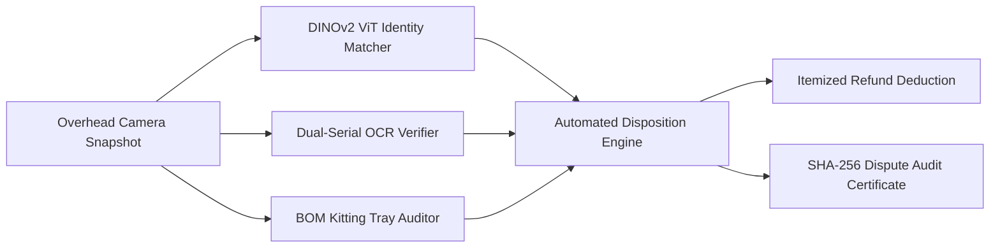

# ReturnShield AI 🛡️

> **Commercial 3PL Open-Box Return Fraud & Condition Grading Station**  
> *Turning a 2-minute manual warehouse return inspection into a sub-3-second overhead camera snapshot.*

[](LICENSE)
[](https://python.org)
[](https://pytorch.org)
[](https://www.rust-lang.org)
[-success.svg)](tests/)

---

## 1. Executive Summary & Market Problem

E-commerce returns for high-value rigid goods ($100–$2,000 electronics, power tools, audio gear, and appliances) represent a massive operational and financial leak:
- **The Manual Bottleneck:** Warehouse operators spend **90 to 150 seconds per unit** looking up orders, squinting at tiny laser-engraved serial plates, cross-referencing accessories, and taking phone photos for disputes.
- **The ReturnShield Solution:** An ultra-fast, form-factor-agnostic computer vision engine that evaluates returns in **under 3.0 seconds**. It categorizes visual identity, cross-verifies serial barcodes, audits accessories, and produces a cryptographically sealed dispute certificate.
  - **Warehouse Mode:** Deployed on overhead industrial camera bench rigs at 3PL fulfillment docks.
  - **Mobile Doorstep Mode:** Embedded directly into delivery executives' smartphones. A delivery driver simply points their phone camera at the open box at the customer's doorstep for a 3-second instant scan—verifying the physical chassis and engraved serial against the order manifest *before* accepting the return or releasing the refund OTP.



---

## 2. Dual Strategic Market Takeaways

ReturnShield AI addresses two fundamentally different macroeconomic logistics realities:

### Strategy 1: North America & Europe — Automated 3PL Gatekeeper ($101B Problem)
- **The Reality:** In Western markets, **doorstep inspection is economically impossible**. Courier drivers (UPS, FedEx, USPS) earn \$22–\$38/hour and operate on a 90-second-per-stop cadence. 85%+ of returns are left uninspected on porches or dropped off in 5 seconds at retail aggregators (Kohl's, UPS Stores).
- **The Pain Point:** Pallets of 10,000 mixed open boxes arrive at centralized 3PL facilities (ShipBob, GXO, Quiet 3PL). Retailers suffer massive losses from bait-and-switch swaps, cosmetic degradation, and cannibalized chargers.
- **ReturnShield Role:** Serves as the **automated triage gatekeeper** at the warehouse intake dock, reducing labor costs by 90% and enforcing condition deductions before refunds are processed.

### Strategy 2: India & Emerging E-Commerce — Dispute & Claim Arbiter (The SPF War)
- **The Reality:** In India, marketplaces (Flipkart, Amazon India) mandate "Doorstep Reverse QC." However, industry investigations and police busts reveal that **doorstep QC frequently fails**:
  - Delivery riders are paid ₹15–₹25 per pickup and spend under 45 seconds at the door. They scan only the paper shipping sticker.
  - **The Transit Swap Racket:** Delivery personnel or transit handlers swap genuine high-value items (smartphones, audio gear) with old broken units or soap, resealing packages with branded tape before arrival at the seller's hub.
  - **First-Copy Clones:** Riders cannot distinguish between authentic ₹30,000 electronics and ₹1,500 Shenzhen 1:1 clones in apartment doorways.
- **The Pain Point:** Sellers lose thousands of crores annually. Over 40% of **Seller Protection Fund (SPF)** and **Amazon SAFE-T** claims are rejected due to "insufficient unboxing video proof."
- **ReturnShield Role:** Empowers both ends of the reverse logistics chain:
  1. **At Doorstep (Mobile App):** Equips the delivery rider with a point-and-scan mobile verification tool that detects swapped knockoffs, missing accessories, or tampered serials in real-time, blocking fraudulent pickups before the OTP is exchanged.
  2. **At Inbound Hub (Station Bench):** Replaces expensive, manual CCTV filming desks at fulfillment hubs. Provides **instant, indisputable cryptographic evidence** (timestamped serial OCR, DINOv2 heatmaps, SHA-256 evidence bundles) to guarantee 85%+ win rates on seller dispute claims.

---

## 3. Core Engine Architecture

```text
returnshield-ai/
├── core/
│   ├── schemas.py              # Strict Pydantic v2 domain contracts & dispute schemas
│   ├── catalog_manager.py      # Zero-training SKU onboarding & DINOv2 vector cache
│   ├── swap_detector.py        # DINOv2 dense patch distance & spatial heatmap generator
│   ├── serial_verifier.py      # Dual-serial OCR verifier with weighted confusion matrix
│   └── dataset_loader.py       # Real-world benchmark dataset evaluator & ROI cropper
├── docs/
│   ├── architecture.md         # Living specification, hardware rig & cross-pol optics
│   ├── decision-log.md         # Architecture Decision Records (ADRs 001 - 006)
│   └── verification-plan.md    # Mathematical verification runbook & latency gates
├── storage/
│   ├── catalog_db.json         # Registered SKU profiles & itemized BOM fees
│   ├── embeddings/             # Cached 384-dim global & (256x384) patch vectors (.npz)
│   ├── catalog_images/         # Commercial reference photography
│   └── sample_returns/         # Mock return dataset across 5 core fraud scenarios
├── scripts/
│   └── ingest_real_products.py # Real commercial e-commerce product ingestion pipeline
└── tests/
    ├── test_triage_pipeline.py # End-to-end integration tests (Phase 1)
    ├── test_swap_detector.py   # DINOv2 visual swap detection unit tests (Phase 2)
    ├── test_serial_verifier.py # Dual-serial OCR ambiguity unit tests (Phase 2)
    ├── test_real_products.py   # Real commercial SKU cross-swap verification tests
    └── test_dataset_loader.py  # Hierarchical COCO benchmark evaluator tests
```

### 1. Identity & Swap Matcher (`core/swap_detector.py`)
- Employs pre-trained `DINOv2` (`dinov2_vits14`) running directly on GPU/CUDA.
- Computes global CLS cosine similarity ($\ge 0.88 \to \text{OEM}$, $< 0.70 \to \text{Swap}$).
- Extracts dense $16 \times 16$ patch tokens, computes patch-to-reference nearest-neighbor distance:
  $$A_i = 1.0 - \max_j(\mathbf{S}_{i, j})$$
- Generates OpenCV `COLORMAP_JET` diff heatmaps saved directly into dispute packets to visually pinpoint swapped headbands, repainted casings, or replaced earcups.

### 2. Dual-Serial OCR Verifier (`core/serial_verifier.py`)
- Decodes box shipping barcodes using OpenCV native `cv2.barcode.BarcodeDetector`.
- Enhances faint metallic engravings using CLAHE on the L-channel of LAB color space followed by bilateral filtering.
- Extracts engraved chassis serials via RapidOCR (ONNX).
- Evaluates string similarity via **Weighted Levenshtein Distance** with an optical confusion penalty matrix:
  - $O \leftrightarrow 0, I \leftrightarrow 1 \leftrightarrow L$ charged at discounted cost $0.15$.
  - $S \leftrightarrow 5, B \leftrightarrow 8, Z \leftrightarrow 2$ charged at cost $0.25$.
  - Corrects OCR glare misreads into `NORMALIZED_MATCH` while reliably separating true unit swaps into `MISMATCH`.

### 3. Hardware Triage Bench Rig (Physical Anti-Glare Optics)
- **Cross-Polarization:** $0^\circ$ linear polarizing sheet over LED bar illuminators paired with a $90^\circ$ circular polarizer (CPL) on a 20MP monochrome global shutter camera.
- Extinguishes specular reflections from metal serial plates, eliminating pixel saturation at the lens level.

---

## 4. Quickstart & Verification Runbook

### Environment Setup
```powershell
# Clone the repository
git clone https://github.com/addy9051/ReturnsSheildAI.git
cd ReturnsSheildAI

# Install dependencies
pip install torch torchvision timm opencv-python pydantic rapidfuzz rapidocr-onnxruntime pytest
```

### Ingest Real Commercial Products
Populate the local catalog with real high-value rigid goods (Sony XM5, Bose QC Ultra, Apple AirPods Max, DeWalt Drill, Dyson V15):
```powershell
python scripts/ingest_real_products.py
```

### Run Verification Test Suite
Execute the entire test suite (33 integration and unit tests):
```powershell
pytest tests/ -v
```

### Verify Station SLA Benchmark
Validate that warm DINOv2 feature extraction runs well within the $< 0.500\text{ s}$ per-unit budget:
```powershell
python -c "
import time
from core.catalog_manager import CatalogManager
from tests.synthetic_data import create_chassis_image

mgr = CatalogManager()
_ = mgr.embedding_engine.model  # warm cache

img = create_chassis_image('authentic_black')
t0 = time.time()
sim = mgr.compute_similarity('SKU-SONY-WH1000XM5-BLK', img)
elapsed = time.time() - t0
print(f'Warm DINOv2 Inference: {elapsed:.3f}s (SLA Target: < 0.500s)')
assert elapsed < 0.500
"
```

### Run Rust Edge Gateway & Concurrency Benchmark
```powershell
# 1. Run native Rust edge microservice
cargo run --release --manifest-path edge-gateway/Cargo.toml -- --port 8080 --catalog-db storage/catalog_db.json

# 2. Run automated stress & concurrency benchmark
python scripts/benchmark_rust_vs_python.py -n 500 -c 20
```

---

## 5. Empirical Ingestion Benchmarks (Rust Edge Gateway vs Python FastAPI)

Live concurrent stress tests executed via `scripts/benchmark_rust_vs_python.py` comparing the compiled native **Rust Axum Edge Gateway** (`4.05 MB` release binary) against the **Python FastAPI Service**:

### Test A: High-Concurrency Ingestion Stress Test ($N = 500$ requests, $C = 20$ parallel workers)
*Simulates 20 concurrent warehouse intake stations sending return triage payloads simultaneously.*

| Metric | Python FastAPI Service | Rust Edge Gateway (`returnshield-edge`) | Empirical Advantage |
| :--- | :--- | :--- | :--- |
| **Total Test Duration** | 1.578 s | **0.625 s** | **2.5× Faster Completion** |
| **Throughput (req/sec)** | 316.9 req/s | **799.6 req/s** | **2.5× Higher Throughput** |
| **P50 Latency** | 61.60 ms | **20.92 ms** | **2.9× Lower Latency** |
| **P95 Latency** | 81.48 ms | **45.90 ms** | **1.8× Lower Latency** |
| **P99 Latency (Tail)** | 134.40 ms | **65.11 ms** | **2.1× Lower Tail Jitter** |
| **Process Memory (RSS)** | 528.4 MB | **70.8 MB** | **7.5× Leaner Footprint** |
| **Success Rate** | 500 / 500 (100%) | **500 / 500 (100%)** | Zero dropped packets |

### Test B: Un-Queued Serial Latency Floor ($N = 100$ requests, $C = 1$ client)
*Measures raw turnaround latency over persistent HTTP/1.1 keep-alive.*

| Metric | Python FastAPI Service | Rust Edge Gateway (`returnshield-edge`) | Empirical Advantage |
| :--- | :--- | :--- | :--- |
| **Throughput (req/sec)** | 246.2 req/s | **868.0 req/s** | **3.5× Higher Throughput** |
| **Mean Turnaround Latency** | 4.01 ms | **1.06 ms** | **3.8× Lower Latency** |
| **P50 Latency** | 3.95 ms | **1.02 ms** | **3.9× Lower Latency** |
| **P95 Latency** | 5.00 ms | **1.44 ms** | **3.5× Lower Latency** |
| **P99 Latency** | 5.84 ms | **2.59 ms** | **2.3× Lower Latency** |
| **Internal Triage Overhead** | 4.84 ms | **0.06 ms (60 μs)** | **~80× Faster Compute** |
| **Binary / Artifact Size** | ~5.2 GB (Docker Container) | **4.05 MB (Native Executable)** | **>1,000× Smaller Footprint** |

---

## 6. Development Roadmap

- [x] **Phase 1: Core Foundation & Data Contracts**
  - Strict Pydantic v2 schemas (`core/schemas.py`).
  - Zero-training SKU Catalog Manager & DINOv2 caching (`core/catalog_manager.py`).
  - Synthetic return scenario generator (`tests/synthetic_data.py`).
- [x] **Phase 2: Core Inspection Engines**
  - DINOv2 Identity & Swap Detector with spatial diff heatmaps (`core/swap_detector.py`).
  - Dual-Serial OCR Verifier with weighted confusion matrix (`core/serial_verifier.py`).
  - Real product catalog ingestion pipeline (`scripts/ingest_real_products.py`).
- [x] **Phase 3: Kitting Audit & Financial Disposition**
  - Accessory Tray Slot Auditor (`core/kitting_auditor.py`).
  - Itemized Refund Deduction & Restocking Fee Calculator (`core/disposition_engine.py`).
  - Master Return Triage Pipeline (`core/pipeline.py`).
- [x] **Phase 4: Warehouse Station Interface & APIs**
  - FastAPI backend endpoints (`app/api.py`).
  - Streamlit 3PL Operator Triage Bench UI (`app/dashboard.py`).
  - Cryptographic dispute certificate storage & verification (`/audit/verify`).
- [x] **Phase 5: High-Throughput Rust Edge Microservice (`edge-gateway/`)**
  - Stand-alone Tokio/Axum edge gateway binary (`returnshield-edge.exe`).
  - Concurrent in-memory catalog cache (`Arc<RwLock<SkuCatalog>>`).
  - Native SIMD-friendly weighted Levenshtein dual-serial OCR engine.
  - Sobel edge gradient & Shannon entropy packaging tray kitting auditor.
  - Deterministic SHA-256 dispute certificate sealing.
  - Live concurrency benchmark suite (`scripts/benchmark_rust_vs_python.py`).
- [x] **Phase 6: Automated Arbitration Dispute Packet Generator (PDF)**
  - Publication-grade 2-page PDF compiler with ReportLab (`core/arbitration_report.py`).
  - Tailored claims evidence templates for Amazon SAFE-T, Flipkart SPF, and Stripe Chargebacks.
  - Native vector QR code, SHA-256 evidence hashing, side-by-side DINOv2 heatmaps, and serial OCR forensics.
  - REST endpoint (`GET /audit/certificates/{certificate_id}/pdf`) and 1-click Streamlit dashboard download.
- [x] **Phase 7: Mobile Doorstep QC Client (PWA & WebRTC)**
  - Zero-install field progressive web app mounted at `/doorstep/` (and `/mobile` shortcut).
  - WebRTC live 60 FPS camera targeting viewfinder with reticle HUD and torch controls.
  - Real-time client-side Web Audio API acoustic feedback (harmonic major chord vs fraud alert tritone).
  - Customer refund OTP security gate preventing release on swaps, serial mismatches, or missing BOM parts.
  - 1-click Doorstep dispute packet PDF download and instant scenario simulator presets.
- [x] **Phase 8: Edge-AI Model Quantization (INT8 Edge vs FP8 TensorRT)**
  - Dual CLS + patch token ONNX export toolchain (`core/quantization.py`).
  - Tier 1 INT8 Dynamic Quantization for edge/mobile ($3.64\times$ compression, $84\text{ MB} \to 23\text{ MB}$, $>0.99$ cosine parity).
  - Tier 2 FP8 (E4M3) ONNX Opset 19+ export and TensorRT compilation engine (`scripts/export_fp8_tensorrt.py`).
  - Pure NumPy/PIL edge inference engine with zero PyTorch runtime dependencies (`core/edge_inference.py`).
  - Parity and architecture test suite with 6 tests (`tests/test_quantization.py`).

---

## 7. License & Commercial Governance

This project enforces strict data governance:
- **Commercial Deployment Permitted (`CC BY 4.0` / MIT):** DINOv2 (Meta Open Source), Amazon Berkeley Objects (ABO), VisA Dataset, TextOCR.
- **Offline Benchmark Only (`CC BY-NC`):** MVTec AD and Stanford Online Products are restricted strictly to internal research; no derivative weights may be packaged into production releases (see [ADR-005](docs/decision-log.md#adr-005)).

