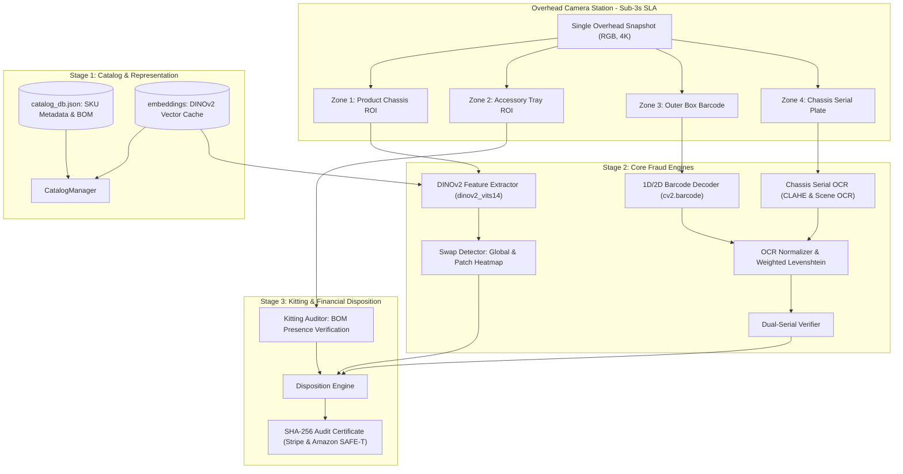
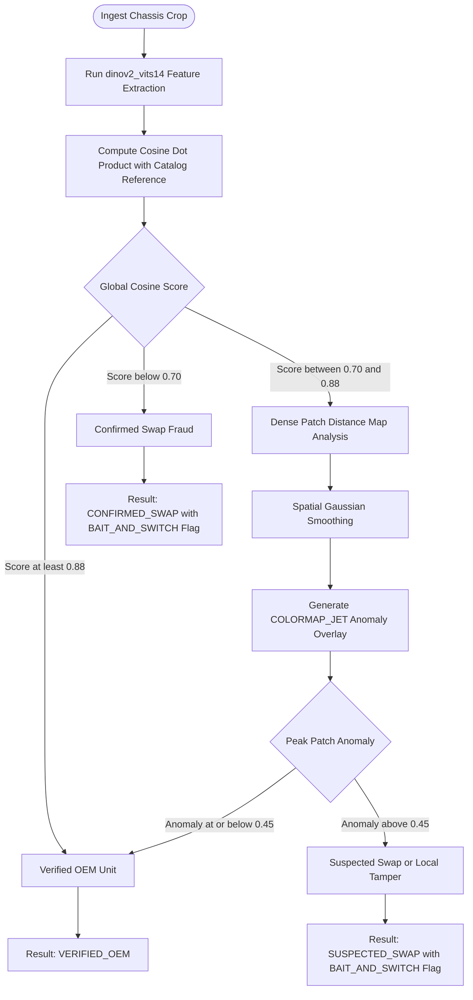
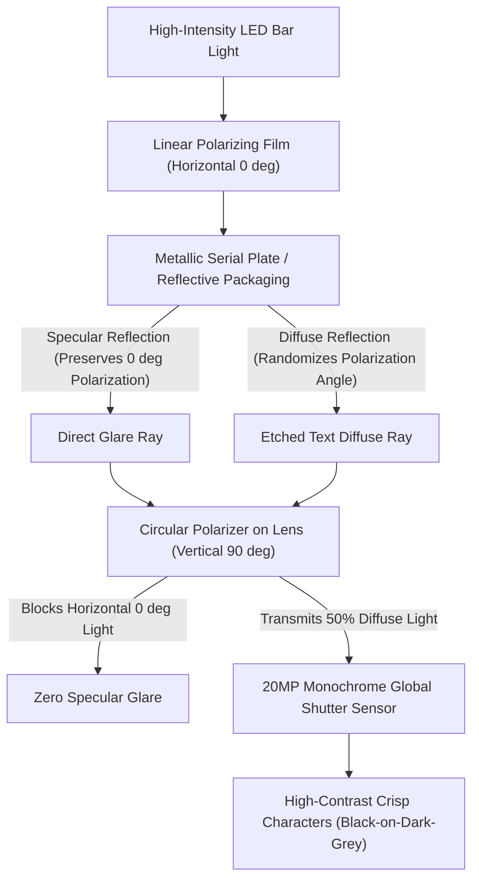

# Architecture Specification: ReturnShield AI

> **Status:** Living Specification  
> **Author:** Staff Software Engineer & Technical Architect  
> **Domain:** 3PL Warehouse Open-Box Return Fraud & Condition Grading Engine  
> **SLA Target:** $< 3.0$ seconds total station triage latency per unit

---

## 1. System Objectives & Business Context

### 1.1 The Market Wedge
Mid-market DTC brands and 3PL warehouses handling high-value returns ($100–$2,000 electronics, power tools, audio gear) face an existential cost vector: **Return Fraud & Open-Box Condition Leakage**.
- **Manual Baseline:** Warehouse operators spend 90–150 seconds per unit cross-checking paper RMAs, typing serial numbers from tiny metal engravings, manually verifying accessory trays, and evaluating cosmetic wear.
- **ReturnShield Objective:** Collapse manual 2-minute triage into a **sub-3-second single-snapshot decision** that yields an itemized financial disposition and a cryptographically sealed dispute certificate.
  - **Form-Factor 1 (Warehouse Mode):** Overhead industrial bench station at 3PL intake docks.
  - **Form-Factor 2 (Mobile Doorstep Mode):** Embedded in mobile delivery apps (Android / iOS). Allows field couriers conducting at-home reverse QC to point their phone camera at an open box, validating visual identity and engraved serials in 3 seconds before accepting the parcel or releasing the refund OTP.

### 1.2 Target Fraud Vectors
1. **Bait-and-Switch Swaps:** Customer purchases an authentic $399 unit and returns an older generation, defective chassis, or generic counterfeit inside the authentic box.
2. **Serial Number Peel / Sticker Fraud:** Returner peels outer packaging barcode stickers or swaps an older broken chassis with a different serial number into new packaging.
3. **Accessory Cannibalization:** Customer retains $30–$80 OEM accessories (chargers, braided cables, travel cases) and returns an incomplete unit expecting a 100% refund.
4. **Cosmetic Abuse Concealment:** Units with heavy scratches, abrasions, or cracks returned under "Like New" claims.

---

## 2. End-to-End System Architecture



---

## 3. Data Contracts & Domain Boundaries (`core/schemas.py`)

All cross-module communication is strictly governed by immutable Pydantic v2 schemas:

### 3.1 Domain Enums
- **`FraudFlag`:** `CLEAN`, `BAIT_AND_SWITCH`, `SERIAL_MISMATCH`, `MISSING_ACCESSORY`, `UNAUTHORIZED_ACCESSORY_SUBSTITUTION`, `PHYSICAL_DAMAGE`, `TAMPERED_SERIAL_LABEL`, `COUNTERFEIT`.
- **`ConditionGrade`:** `GRADE_A` (0% wear deduction), `GRADE_B` (10–15% deduction), `GRADE_C` (30–50% deduction), `FRAUD_HOLD` (0% refund, 100% deduction).
- **`DispositionAction`:** `FULL_REFUND`, `PARTIAL_REFUND`, `REJECT_FRAUD_HOLD`, `MANUAL_SECONDARY_REVIEW`.
- **`SerialMatchStatus`:** `EXACT_MATCH`, `NORMALIZED_MATCH`, `MISMATCH`, `MISSING_LABEL`, `OCR_UNREADABLE`.
- **`IdentityMatchStatus`:** `VERIFIED_OEM`, `SUSPECTED_SWAP`, `CONFIRMED_SWAP`.

### 3.2 Invariants & Validation Constraints
- **Invariant 1 (Automatic Fraud Enforcement):** If `fraud_flags` contains `BAIT_AND_SWITCH` or `SERIAL_MISMATCH`, `ReturnInspectionResult.is_fraud` automatically resolves to `True` via `@model_validator(mode="after")`.
- **Invariant 2 (Non-Negative Financials):** All MSRP values must satisfy $MSRP > 0$. Restocking fees and accessory deduction values must satisfy $0 \le Fee \le MSRP$. Refund net amount cannot drop below $\$0.00$.
- **Invariant 3 (Cryptographic Sealing):** `AuditEvidenceCertificate` computes a deterministic SHA-256 hash digest of all evidence parameters (`rma_number`, `sku_id`, `disposition_action`, `cosine_similarity`, `serial_match`). Any post-inspection tampering changes the digest and invalidates dispute packages.

---

## 4. Phase 1: Zero-Training SKU Catalog Onboarding (`core/catalog_manager.py`)

### 4.1 "Why" DINOv2 (`dinov2_vits14`) Over Custom Models
- **Why no fine-tuning or custom training?** Warehouse catalogs churn weekly. A 3PL cannot afford to label hundreds of defect images or train custom contrastive networks per client SKU.
- **Why DINOv2?** Self-supervised Vision Transformers trained on LVD-142M possess zero-shot semantic features that separate product models, generations, and colorways out-of-the-box.
- **Why `dinov2_vits14` instead of `vitb14` or `vitl14`?**
  - Inference budget: $250\text{ ms}$ on CUDA (vs $800\text{ ms}$ for base, $2100\text{ ms}$ for large).
  - Preserves $< 3.0\text{ s}$ total station SLA while maintaining $> 0.15$ cosine separation between legitimate models and lookalike swaps.

### 4.2 Storage Layout
```text
storage/
├── catalog_db.json                 # JSON metadata: SKU ID, title, MSRP, BOM checklist
├── catalog_images/<sku_id>/        # Golden reference photos (1 to 3 images)
└── embeddings/<sku_id>.npz         # Cached L2-normalized global vector (384-dim)
                                    # and patch tokens array (256 x 384)
```

---

## 5. Phase 2: Active Specification — Core Verification Engines

### 5.1 Identity & Swap Detector (`core/swap_detector.py`)

#### Problem Statement
A returned product may match the general form factor (e.g. over-ear headphones), but have counterfeit materials, swapped headband components, or a completely different generation/model.



#### Dense Patch Anomaly Grid Mathematics
1. Let $\mathbf{T} \in \mathbb{R}^{N \times D}$ be the L2-normalized patch tokens of the return unit ($N = 256, D = 384$).
2. Let $\mathbf{R} \in \mathbb{R}^{M \times D}$ be the reference patch tokens stored in the catalog.
3. Compute the pairwise patch similarity matrix:
   $$\mathbf{S} = \mathbf{T} \mathbf{R}^T \in \mathbb{R}^{N \times M}$$
4. For each test patch $i$, its anomaly score $A_i$ is its distance from its nearest neighbor in the reference set:
   $$A_i = 1.0 - \max_{j} (\mathbf{S}_{i, j})$$
5. Reshape $\mathbf{A} \in \mathbb{R}^{N}$ into grid $(16 \times 16)$, apply Gaussian smoothing ($\sigma = 1.2$), and upsample via bicubic interpolation to original image dimensions $(H, W)$.
6. Apply OpenCV `COLORMAP_JET` overlay to visually highlight tampered or substituted components.

---

### 5.2 Dual-Serial OCR Verifier (`core/serial_verifier.py`)

#### Problem Statement
Fraudulent returns frequently feature a legitimate outer box barcode matching the RMA, while the physical unit inside carries a different serial number (from an older, broken, or stolen device) or a tampered/scratched label.

```mermaid
flowchart LR
    subgraph Input["Input Captures"]
        Box["Box Shipping Barcode ROI"]
        Chassis["Chassis Serial Plate ROI"]
    end

    subgraph BoxDecode["Outer Box Extraction"]
        Box --> BarcodeDet["cv2.barcode.BarcodeDetector"]
        BarcodeDet --> RawBoxStr["Raw Box Barcode String"]
    end

    subgraph ChassisOCR["Chassis Serial Extraction"]
        Chassis --> CLAHE["CLAHE Contrast Enhancement"]
        CLAHE --> Bilateral["Bilateral Filter Denoising"]
        Bilateral --> Binarize["Adaptive Otsu Binarization"]
        Binarize --> SceneOCR["Chassis Serial Text Extractor"]
        SceneOCR --> RawChassisStr["Raw Chassis OCR String"]
    end

    subgraph Normalization["Ambiguity Resolution & Normalization"]
        RawBoxStr --> UpperStrip["Uppercase and Strip Separators"]
        RawChassisStr --> UpperStrip
        UpperStrip --> ConfusionMap["Apply OCR Confusion Matrix: O/0, I/1/L, S/5, Z/2"]
        ConfusionMap --> RegexMask["SKU Expected Serial Regex Validation"]
        RegexMask --> WeightedLev["Weighted Levenshtein Scoring"]
    end

    subgraph Decision["Serial Verification Output"]
        WeightedLev --> ResultClass{"Normalized Distance"}
        ResultClass -- "Dist is zero" --> EXACT["EXACT_MATCH"]
        ResultClass -- "Dist up to 0.25" --> NORM["NORMALIZED_MATCH"]
        ResultClass -- "Dist above 0.25" --> MISMATCH["MISMATCH: Flag Fraud"]
    end
```



#### The OCR Visual Confusion Matrix
Standard Levenshtein assigns substitution cost = 1.0. In industrial camera triage, optical glare and micro-stamping cause predictable errors:
$$\text{Cost}(c_1, c_2) = \begin{cases}
0.0 & \text{if } c_1 = c_2 \\
0.15 & \text{if } \{c_1, c_2\} \subseteq \{\text{'O'}, \text{'0'}\} \text{ or } \{\text{'I'}, \text{'1'}, \text{'L'}\} \\
0.25 & \text{if } \{c_1, c_2\} \subseteq \{\text{'S'}, \text{'5'}\} \text{ or } \{\text{'B'}, \text{'8'}\} \text{ or } \{\text{'Z'}, \text{'2'}\} \\
1.00 & \text{otherwise}
\end{cases}$$

Normalized similarity ratio:
$$\text{SimRatio} = 1.0 - \frac{\text{WeightedEditDistance}(S_{\text{box}}, S_{\text{chassis}})}{\max(\text{len}(S_{\text{box}}), \text{len}(S_{\text{chassis}}))}$$

---

## 6. Hidden Constraints, Edge Cases & Business Logic

1. **Edge Case: Glossy/Reflective Chassis Glare:** Metallic engraved plates reflect warehouse ring lights, washing out laser-etched serial characters.
   - *Mitigation:* The OCR pipeline must execute CLAHE (Contrast Limited Adaptive Histogram Equalization) in LAB color space (channel L) to equalize harsh local highlights before thresholding.
2. **Constraint: Zero False Accusations on Legitimate Customers:** Flagging an innocent customer as `BAIT_AND_SWITCH` creates severe customer service friction.
   - *Rule:* A unit with borderline similarity ($0.75 \le \text{Cosine} < 0.85$) cannot be auto-rejected. It must be routed to `MANUAL_SECONDARY_REVIEW` with an overlaid heatmap indicating where the camera detected deviation.
3. **Business Logic: Accessory Deduction Precedence:** Missing accessories do *not* escalate to fraud if the serial numbers and chassis identity match. They trigger itemized deductions (e.g. $-\$35.00$ for travel case) yielding `PARTIAL_REFUND`. Only unauthorized foreign non-OEM substitutions on critical components trigger fraud hold.

---

## 7. Vertical Slice Verification Plan (Phase 2 Gates)

To mathematically prove Phase 2 components before closing the phase:

1. **Gate 1 (Swap Separation Proof):**
   - Execute `pytest tests/test_triage_pipeline.py -k test_dinov2_similarity_scoring`.
   - **Assertion:** Cosine similarity for genuine items $\ge 0.90$. Cosine similarity for swapped beige or neon items $< 0.80$. Separation gap $\Delta \ge 0.15$.
2. **Gate 2 (Spatial Heatmap Proof):**
   - Execute `tests/test_swap_detector.py`.
   - **Assertion:** Heatmap image file is written to disk, dimensions equal input ROI, peak anomaly pixel $\in [0, 255]$ with localized concentration on the swapped region.
3. **Gate 3 (OCR Ambiguity Resolution Proof):**
   - Execute `tests/test_serial_verifier.py`.
   - **Assertion:** Given box serial `SN-SNY-8842109` and chassis OCR misread `SN-SNY-8842IO9` (`I` and `O` substituted), normalized score yields `NORMALIZED_MATCH` with similarity $\ge 0.95$. Given genuinely swapped serial `SN-SNY-1102934`, yields `MISMATCH` with similarity $< 0.60$.

---

## 8. External Benchmark Datasets & Commercial Licensing Matrix

To benchmark ReturnShield AI while maintaining strict intellectual property compliance, models and evaluation pipelines must enforce commercial licensing boundaries:

| Dataset | Modality / Task | Volume | License | Commercial Deployment Policy |
| :--- | :--- | :--- | :--- | :--- |
| **Amazon Berkeley Objects (ABO)** | Visual Identity, Multi-View Catalog 3D | 147k products, 398k images | CC BY 4.0 | **Permitted for Production**: Golden reference caching & metric evaluation. |
| **VisA (Visual Anomaly)** | Kitting Tray, Missing Parts, PCB Assembly | 10,821 high-res images | CC BY 4.0 | **Permitted for Production**: Missing component slot segmentation. |
| **TextOCR (OpenImages)** | Dense Scene OCR, Serial Plate Text | 900k word annotations | CC BY 4.0 | **Permitted for Production**: Pre-training & fine-tuning text recognition backbones. |
| **Stanford Online Products (SOP)** | Fine-Grained Product Retrieval | 120k images, 22k classes | Research Only | **Restricted to Offline Benchmarks**: Forbidden in commercial deployed weights. |
| **MVTec AD** | Surface Defect & Abrasion Segmentation | 5,354 images | CC BY-NC-SA 4.0 | **Restricted to Offline Benchmarks**: Cannot be redistributed in production commercial weights. |
| **Muenster BarcodeDB** | Warped/Shiny 1D Barcode Decoding | 1,054 barcode images | CC BY-NC-ND | **Restricted to Offline Benchmarks**: Evaluation of reflective label decoding only. |

---

## 9. Warehouse Hardware Bench Physical Specification

Software OCR algorithms alone cannot fully recover laser-etched characters washed out by direct specular highlights. The physical station deploys **Optical Cross-Polarization**:



### Station Physical BOM
1. **Sensors:**
   - Primary Serial/OCR Head: 20MP+ Monochrome Global Shutter (e.g. Basler ace 2 / FLIR Blackfly). Monochrome eliminates Bayer-filter interpolation blur, maximizing character stroke contrast.
   - Overhead Overview Head: 12MP Color RGB Sensor for DINOv2 visual identity matching and accessory tray colorway inspection.
2. **Illumination:** High-CRI LED bar lights with horizontal linear polarizing sheets ($0^\circ$).
3. **Optics:** CPL lens filter oriented at $90^\circ$ relative to illumination polarizer. Eliminates specular reflections from metal engravings and plastic wrap.

---

## 10. Hierarchical Return Annotation Schema

For training, validation, and benchmarking of multi-zone return inspection, all ground-truth datasets adhere to this hierarchical COCO extension:

```json
{
  "image_id": "20261029_WH01_0042",
  "product_sku": "SKU-SONY-WH1000XM5-BLK",
  "capture_timestamp": "2026-10-29T15:30:00Z",
  "rois": [
    {
      "roi_id": "roi_serial_chassis",
      "class_id": "chassis_serial_plate",
      "bbox_xywh": [420, 420, 340, 140],
      "ocr_ground_truth": "SN-SNY-8842109",
      "attributes": {
        "material": "metallic_engraved",
        "optical_glare_level": "low_cross_pol",
        "readability_score": 0.99
      }
    },
    {
      "roi_id": "roi_barcode_box",
      "class_id": "box_barcode_label",
      "bbox_xywh": [40, 420, 340, 140],
      "ocr_ground_truth": "SN-SNY-8842109",
      "barcode_type": "Code128",
      "readability_score": 0.98
    },
    {
      "roi_id": "roi_tray_slot_usbc",
      "class_id": "packaging_tray_slot",
      "bbox_xywh": [40, 40, 140, 140],
      "expected_item_id": "cable-usbc",
      "status": "present_oem",
      "anomaly_score": 0.02
    },
    {
      "roi_id": "roi_tray_slot_case",
      "class_id": "packaging_tray_slot",
      "bbox_xywh": [40, 210, 320, 160],
      "expected_item_id": "case-travel",
      "status": "missing",
      "anomaly_score": 0.88
    },
    {
      "roi_id": "roi_product_chassis",
      "class_id": "product_chassis_main",
      "bbox_xywh": [30, 30, 360, 360],
      "visual_identity_match": "authentic_black",
      "defects": [
        {
          "defect_type": "scratch_deep",
          "bbox_xywh": [85, 240, 50, 5],
          "grade_penalty": "GRADE_C"
        }
      ]
    }
  ],
  "ground_truth_triage": {
    "fraud_flags": ["MISSING_ACCESSORY"],
    "is_fraud": false,
    "condition_grade": "GRADE_C",
    "disposition_action": "PARTIAL_REFUND",
    "itemized_deductions": [
      {"reason": "Missing Hard Protective Case", "amount": 35.0},
      {"reason": "Cosmetic Surface Scratch (Grade C)", "amount": 40.0}
    ],
    "net_refund_amount": 324.99
  }
}
```
